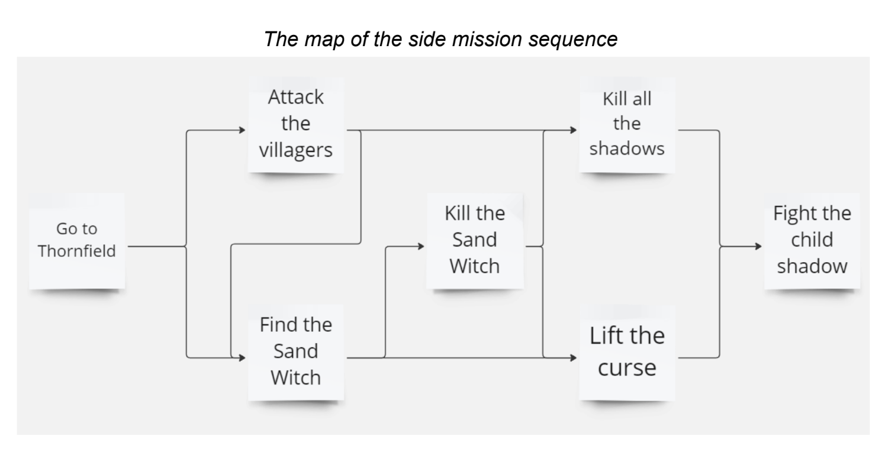

[Diablo 4 style branching side mission sequence](https://drive.google.com/file/d/1NocLjJsZpqCCPLm0WeDFNzytpBaBDbFm/view?usp=sharing){:target="_blank"} shows how I craft a branching narrative for slasher or RPG-type games. My goal was to enrich the game world and create a lasting impact on players. This mission sequence emphasizes combat and exploration gameplay within a haunting and eerie atmosphere, and offers players multiple choices, moral dilemmas, and encounters, contributing to the dark fantasy setting.

The tale begins at Nightfall Citadel, where the main hero stumbles upon a tragedy – a dying woman's plea to save her child, taken to the cursed village of Thornfield. Venturing into Thornfield reveals a gruesome secret: a curse forces the villagers into a horrific choice – sacrifice a child each year or transform into monstrous entities. But is it really the curse forcing them?
